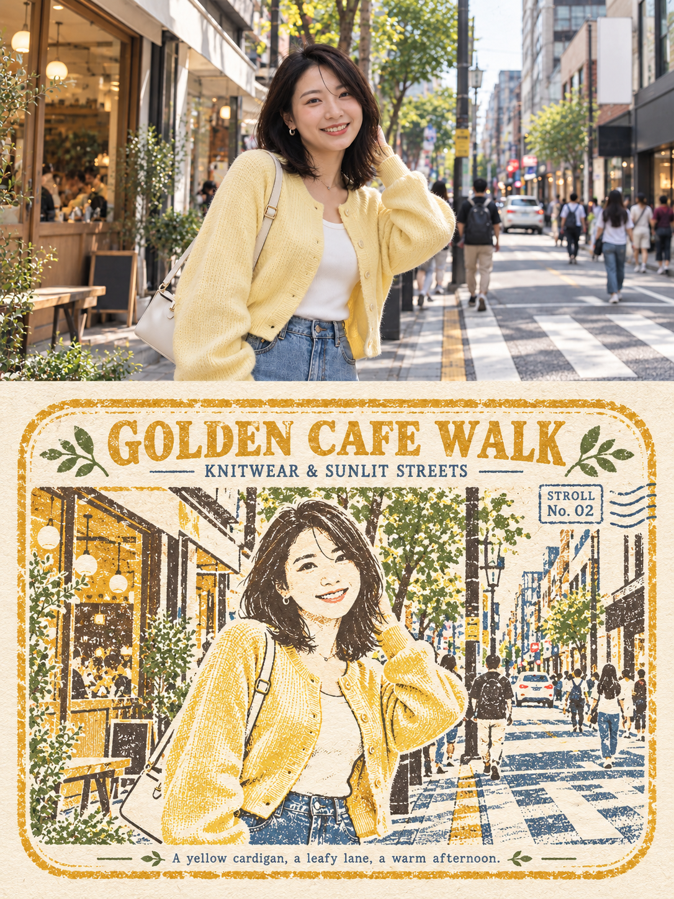
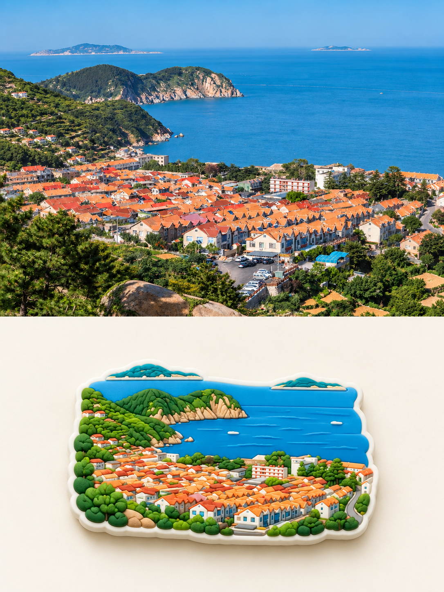
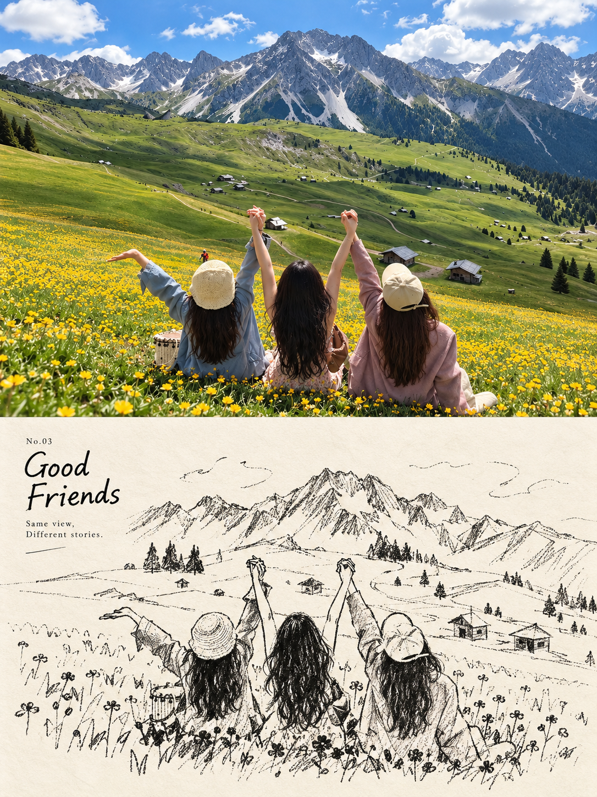

# 旅行照片创意海报

**一个 Skill，八种风格。上传照片，选一个名字，把旅行与日常变成一张专属海报。**

技能标识：`travel-photo-journal`。整体为3:4竖版，上半保留照片，下半以所选风格重新表达。每张源照片只输出一个成功版本。

## 看图选风格

| 编号 | 风格 | 特点 |
|---|---|---|
| 01 | [旅行涂鸦手帐](#style-01) | 把照片里的九个记忆点画成蜡笔和彩铅小图标，配上松散九宫格与手写文字。 |
| 02 | [厚涂油画微景观](#style-02) | 把照片的核心场景重塑为立体油彩微景观，保留调色刀痕、厚重颜料与鲜活色彩。 |
| 03 | [复古印章旅记](#style-03) | 将同一场景化为斑驳油墨的旅行纪念章，让专属英文短句融入版画结构。 |
| 04 | [水粉拼贴插画](#style-04) | 用带水粉颗粒的拼贴块面概括照片，小型视觉岛与大面积留白形成轻松的杂志感。 |
| 05 | [照片故事插画](#style-05) | 让照片里的一条线、一处边缘或一个结构跨入纸面，继续发生一个极简手绘小故事。 |
| 06 | [浮雕冰箱贴](#style-06) | 把照片中的人物或风景概括成一枚异形软胶浮雕冰箱贴，呈现清晰层次与商品实物感。 |
| 07 | [极简编辑插画](#style-07) | 用低饱和色块、细腻干性笔触和留白，留下照片里最值得记住的一到三个主体。 |
| 08 | [旅行线稿速写](#style-08) | 把人物、动作和关键景物化为黑白钢笔速写，以断线、排线和纸面留白记录旅途。 |

<a id="style-01"></a>
### 01 旅行涂鸦手帐

把照片里的九个记忆点画成蜡笔和彩铅小图标，配上松散九宫格与手写文字。


**这样调用：** 上传源照片后说：「用旅行涂鸦手帐处理这张照片，只输出一张。」

[查看完整提示词](references/travel.md)

<a id="style-02"></a>
### 02 厚涂油画微景观

把照片的核心场景重塑为立体油彩微景观，保留调色刀痕、厚重颜料与鲜活色彩。


**这样调用：** 上传源照片后说：「用厚涂油画微景观处理这张照片，只输出一张。」

[查看完整提示词](references/impasto.md)

<a id="style-03"></a>
### 03 复古印章旅记

将同一场景化为斑驳油墨的旅行纪念章，让专属英文短句融入版画结构。



**这样调用：** 上传源照片后说：「用复古印章旅记处理这张照片，只输出一张。」

[查看完整提示词](references/rubber-stamp.md)

<a id="style-04"></a>
### 04 水粉拼贴插画

用带水粉颗粒的拼贴块面概括照片，小型视觉岛与大面积留白形成轻松的杂志感。


**这样调用：** 上传源照片后说：「用水粉拼贴插画处理这张照片，只输出一张。」

[查看完整提示词](references/cutout.md)

<a id="style-05"></a>
### 05 照片故事插画

让照片里的一条线、一处边缘或一个结构跨入纸面，继续发生一个极简手绘小故事。


**这样调用：** 上传源照片后说：「用照片故事插画处理这张照片，只输出一张。」

[查看完整提示词](references/second-world.md)

<a id="style-06"></a>
### 06 浮雕冰箱贴

把照片中的人物或风景概括成一枚异形软胶浮雕冰箱贴，呈现清晰层次与商品实物感。



**这样调用：** 上传源照片后说：「用浮雕冰箱贴处理这张照片，只输出一张。」

[查看完整提示词](references/pvc-magnet.md)

<a id="style-07"></a>
### 07 极简编辑插画

用低饱和色块、细腻干性笔触和留白，留下照片里最值得记住的一到三个主体。


**这样调用：** 上传源照片后说：「用极简编辑插画处理这张照片，只输出一张。」

[查看完整提示词](references/minimal-editorial.md)

<a id="style-08"></a>
### 08 旅行线稿速写

把人物、动作和关键景物化为黑白钢笔速写，以断线、排线和纸面留白记录旅途。



**这样调用：** 上传源照片后说：「用旅行线稿速写处理这张照片，只输出一张。」

[查看完整提示词](references/travel-sketch.md)

## 安装与使用

适用于支持本地 Skills 且具备内置 imagegen 图片生成与编辑能力的 Codex 环境。本 Skill 提供工作流、提示词和参考图，不包含图像模型或独立 API 服务。

在具有技能安装能力的 Codex 中发送：

```text
请从 https://github.com/guoyafen/travel-photo-journal 安装这个 Skill，技能名为 travel-photo-journal。
```

已有旧版时，请更新同名 Skill。手动安装可点击仓库的 Code → Download ZIP，解压后将 `SKILL.md`、`agents/`、`references/`、`assets/` 一起放入 `~/.codex/skills/travel-photo-journal/`（自定义 CODEX_HOME 时使用其 skills 子目录）。保持目录结构，不要只复制 SKILL.md。

安装或更新后，在新一轮对话中上传源照片并发送：

```text
使用 $travel-photo-journal，用第5种「照片故事插画」处理这张照片，只输出一张。
```

未指定风格时默认第1种「旅行涂鸦手帐」。标题、语言和其他偏好可以在当次请求中提出。明确要求处理多张时逐张输出，不合并成一张。

## 关于示例与生成结果

- 示例都是风格参考，实际生成以你上传的源照片为依据，不会把样图人物或场景套入你的照片。
- 多数风格以上下各50%为目标；极简编辑插画采用约1:1，照片故事插画允许指定结构跨过中线。模型可能产生比例、身份或细节偏差，不承诺逐像素还原。
- 首张成功结果即交付，不自动追加修正版。想调整时再明确提出。
- 浮雕冰箱贴呈现的是视觉设计效果，实际生产仍需要另行确认尺寸、结构和工艺。
- 图片只作为使用效果参考；本仓库不包含原始照片合集或个人工作记录。

## 文件结构

```text
travel-photo-journal/
├── SKILL.md          # 共同流程与八种风格选择
├── agents/
│   └── openai.yaml   # 名称与默认调用方式
├── references/       # 每种风格的独立提示词
└── assets/           # 八张对应效果示例
```
