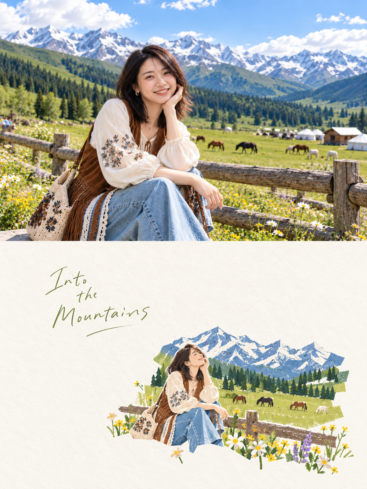

# 04 水粉拼贴插画

英文名称：Gouache Collage。别名：gouache-collage、留白剪纸插画、cutout、Textured Cut-out、粗粝剪纸。

## 风格判断与执行要点

主体以粗糙几何硬边、干性水粉与彩铅颗粒重新组织，保留漏白与擦痕。图形占下半约15–25%为提示词目标，不把样图当作严格面积验证。固有色鲜活，不压成统一灰调；避免与第7种低饱和柔和笔触混用。

遵守主 SKILL.md 的共同执行流程；只加载本风格，不叠加其他风格规则。

## 效果参考

这是已提供的效果示例，用于理解画风，不是源照片；不复制示例主体、背景或文案到其他照片。效果图可能有分区或细节偏差，文字要求与用户当次明确指令为生成目标。

## 完整生成提示词

每张上传照片分别制作一张独立高级设计海报，不拼接，单独输出。整体3:4竖版，上下严格1:1，各占50%。
上半部分完整保留原始照片，保持主体身份、结构、姿态、比例、真实质感、自然光影与原有色彩，仅做轻微高级调色，呈现艺术杂志与展览摄影质感。可自然延展背景适配画幅，但不得拉伸、扭曲或改变主体。
下半部分提取原照最具识别性的主体、轮廓、结构、走势与叙事关系，重构为 Textured Cut-out Editorial Spot Illustration｜粗粝剪纸感点状编辑插画。不要完整转绘或缩小复刻，只保留少数核心视觉记忆点，以不规则几何块面、粗糙剪纸硬边和少量叠压重新概括，使其能与上方照片对应，却不是照片翻版。
构图强调“极小图形＋极大留白”。实体图形仅占下半画面约15–25%，其余保持干净纸白。主体与极少量辅助元素组成小型视觉岛，可依原图重心偏心、靠下、靠侧、悬置或局部裁切，禁止均匀铺满。留白承担空气、距离、节奏和空间，使画面呈现高级杂志 spot illustration 般的小、准、松、静。
造型使用少量不规则多边形、硬边色块和大角度轮廓，保留手工误差、棱面感与粗糙剪纸边，不追求圆润、精确透视或写实体积。内部采用水粉、干粉彩、彩铅式颗粒铺色，保留漏白、擦痕、不均匀颜料与纸张颗粒，只做足够识别主体的选择性明暗。避免湿水彩、完整光影、光滑矢量和3D感。
配色采用“大片白纸＋小面积真实固有色”。白色或极浅暖白占主导，不统一套色；从原照提取有记忆点的 local color 并适度提纯提亮。植物保留绿，花果保留红粉，阳光保留橙黄，水与天空保留青蓝，木材、食物、器物保留自身棕、米、紫、灰。多色可并存，以大片白色隔开，鲜活但不喧闹。不要统一压灰、莫兰迪化、暖黄滤镜或刻意降饱和；黑色仅少量用于文字或视觉锚点。
文字只作少量编辑性介入，可从主体、动作、地点、生活细节、情绪或隐喻中提炼少量字词或短句，以轻巧、略带手工印刷感的字体进入留白，不限定语种与固定格式。
最终呈现极小视觉岛、大面积纯净留白、粗糙几何剪纸边、干性颗粒、真实固有色与高级编辑排版。每张下半部分都需依原照重新组织视觉重心，避免画面填满、完整场景转绘、灰脏低饱和、黑色粗描边、复杂背景及模板化重复构图。

## 调用示例

使用 $travel-photo-journal，用第4种「水粉拼贴插画」处理这张照片，只输出一张。
