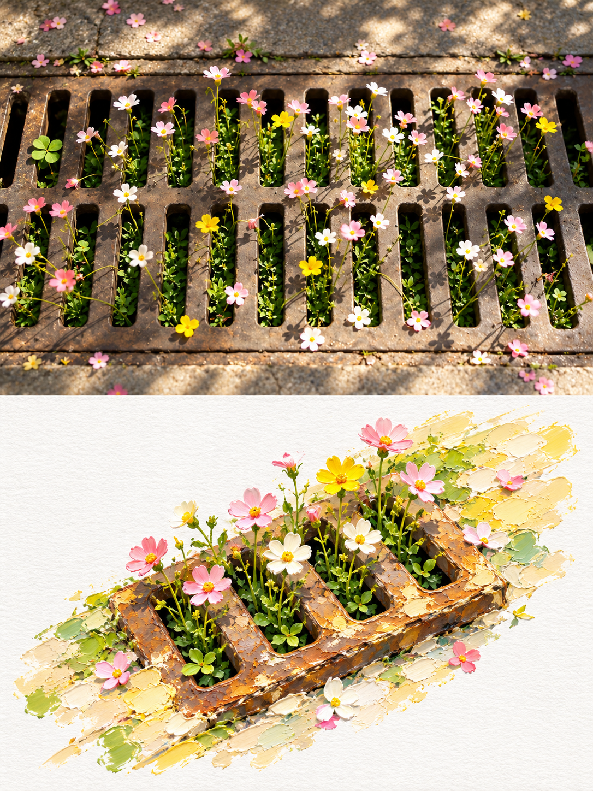

# 02 厚涂油画微景观

英文名称：Impasto Miniature。别名：impasto、厚涂油画、油画微景观。

## 风格判断与执行要点

下半沿对角轴组织微景观，以源图相关的半透明色带支撑主体；油彩堆积与雕塑体积并存。颜色来自源图，不机械添加蓝天、水面等。示例的丰厚景观已被认可，勿自行缩小主体或追加“更多留白”修正版。

遵守主 SKILL.md 的共同执行流程；只加载本风格，不叠加其他风格规则。

## 效果参考

这是已提供的效果示例，用于理解画风，不是源照片；不复制示例主体、背景或文案到其他照片。效果图可能有分区或细节偏差，文字要求与用户当次明确指令为生成目标。

## 完整生成提示词

每张上传的照片，单独创建一个高端设计海报，不要多图拼贴——每张照片单独输出。使用整体3：4的垂直构图，上下部分高度严格为1：1，每个部分占据画面的50%。 上半部分保留了原始照片，保留了主角的身份、结构、比例、逼真的质感、自然光影以及原有的色彩氛围。只需采用细腻的高端彩色分级，才能赋予艺术杂志、独立出版物和展览摄影的质量。为了符合画面，你可以自然延伸天空、地面或环境背景，但不要拉伸、扭曲或改变主体。 下半部分从照片中提取最易识别的主题、轮廓、姿态和叙事关系，将它们重构成3D厚涂油画风格的微型风景插画海报。不要机械复制照片;相反，将主题转化为一个精致、三维、具体的微型景观，通过厚重的笔触、色彩层叠和雕塑般的体积重新塑造。保留主体的核心身份和关键特征，同时适度优化角度、比例和细节，以更好地适应微观景观的呈现。 构图使用大面积负空间+一个居中或略偏中心的对角轴。在明亮的白色纹理纸面上，用与原照片主题相关的半透明厚涂层色带支撑主体，这些色带可以转化为水面、地面、路径、光带或抽象的景观切片;主体自然与色带互动，并根据内容添加反射、波纹、光斑或延展笔触。背景仅保留了与主题相关的浓密云层、阳光、薄雾或自然意象，营造出轻盈且富有诗意的空间层叠感。 绘画语言强调厚涂油画×微型实体，×半透明的光感。保留明显的颜料堆积、调色刀痕、起伏边缘、纸张质感和半手工造型感;在水面、云朵、色带和局部高光上涂上厚厚的涂层，使主体既细腻立体又具备真实油画颜料的质感。 色彩调色板从上方照片中提取最明亮、最鲜艳、最具生命力的颜色，并重新混合，而不是平均颜色。总体而言，提升亮度和色彩纯净度，使用清天蓝、湖绿、温柔绿、暖黄、珊瑚橙、桃粉等自然源自原图的鲜活色调，通过清凉与温暖的关系形成疗愈效果。使用充足的纯暖白色作为呼吸空间，主色鲜艳但不刺眼;局部的暖橙色、金黄色或粉色可以作为阳光点缀，赋予图像一种阳光、清新、温暖、轻松且充满活力的色彩精神。避免灰暗的脏色调、褪色的色调、低调的Morandi化、深棕色滤镜、荧光色和廉价糖果的感觉。

## 调用示例

使用 $travel-photo-journal，用第2种「厚涂油画微景观」处理这张照片，只输出一张。
