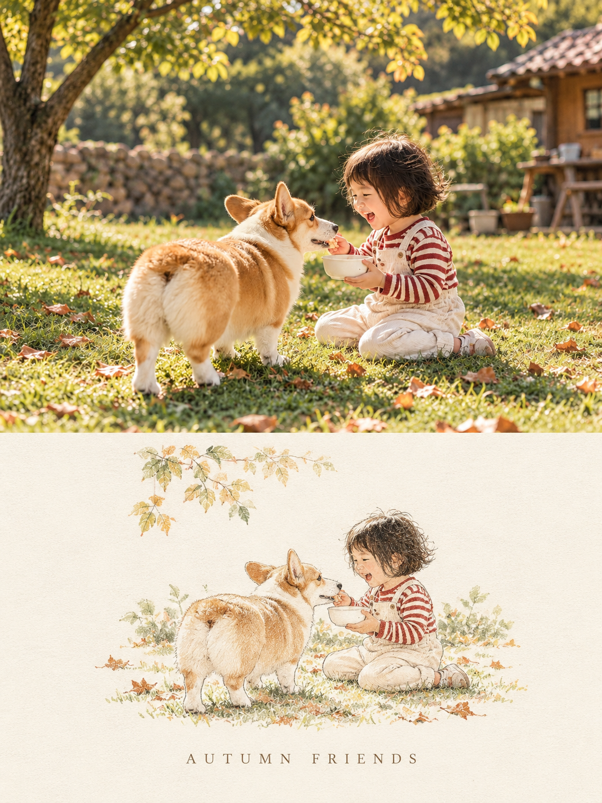

# 07 极简编辑插画

英文名称：Minimal Editorial Illustration。别名：minimal-editorial、极简编辑插画风格。

## 风格判断与执行要点

下半仅保留1–3个核心主体和少量环境，暖纸、低饱和、铅笔彩铅或干刷，柔和克制；区别于第4种鲜活硬边拼贴。英文标题可选，使用大写衬线字与宽字距，不硬加标题。此模式原始提示词要求上下“约1:1”，不要误称严格50:50。

遵守主 SKILL.md 的共同执行流程；只加载本风格，不叠加其他风格规则。

## 效果参考

这是已提供的效果示例，用于理解画风，不是源照片；不复制示例主体、背景或文案到其他照片。效果图可能有分区或细节偏差，文字要求与用户当次明确指令为生成目标。

## 完整生成提示词

请基于我上传的单张照片，生成一张独立的 3:4 竖版「真实摄影 × 极简编辑插画」双分区艺术海报。画面上下约 1:1。上半部分完整保留原始照片的主体、人物/动物身份、动作、物体数量、场景、构图关系、视角、比例、光影、材质和色彩氛围，仅允许为适配版式进行等比裁切、轻微高级调色或自然延展背景，保持真实摄影质感，不重新设计原照片。下半部分使用暖白、米白或浅奶油色的细腻纸张背景，并先自动分析原图中最有辨识度的主体、轮廓、动作、环境层次和视觉关系，再将这些信息压缩成一幅极简、克制的编辑插画。不要完整复制照片，而是只保留 1—3 个最关键主体和少量环境线索，以简化轮廓、低饱和色块、铅笔/彩铅/干刷笔触、轻微颗粒和留白重新表达；人物、动物、建筑、植物或物体都应根据原图内容自适应，不预设固定元素。下方插画面积控制在较小范围，四周保留大量空白，整体像独立杂志、摄影书或艺术展览海报。插画必须与上方照片存在明确对应关系，但不是照片的缩小版。可根据原图自动提取一个最有代表性的主题词，在下方居中加入一行简短英文标题，使用大写、高级衬线字体、较宽字距；若无法提炼合适标题，则不强行加文字。整体保持高级、安静、复古、克制、统一，禁止卡通化、复杂装饰、九宫格、多图拼接、额外说明文字和无关元素。

## 调用示例

使用 $travel-photo-journal，用第7种「极简编辑插画」处理这张照片，只输出一张。
