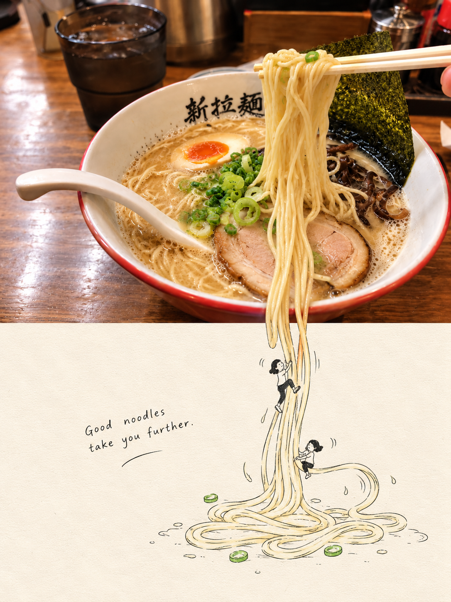

# 05 照片故事插画

英文名称：Photo Story Illustration。别名：照片故事、越界线稿世界、Beyond the Frame、second-world、第二世界、跨界线稿。

## 风格判断与执行要点

只选一个真实具体结构作为锚点，先确定跨中线接口和一种转化逻辑，再决定是否需要0–3个小人。原照已有可延展人物动作则不加人。延续方向、透视、重力与尺度；去掉小人后仍能看出结构相连。最多一个真实或彩色延续元素，4–10个英文单词的轻松旁白。示例面条与攀爬小人不套用到其他照片。

遵守主 SKILL.md 的共同执行流程；只加载本风格，不叠加其他风格规则。

## 效果参考

这是已提供的效果示例，用于理解画风，不是源照片；不复制示例主体、背景或文案到其他照片。效果图可能有分区或细节偏差，文字要求与用户当次明确指令为生成目标。

## 完整生成提示词

请基于每张上传摄影作品分别生成一张独立的3:4竖版“第二世界”摄影二创海报，不拼接、不合并。画面上下严格1:1，各占总高度50%。

上半区完整保留原始摄影作品：主体身份、人物动作、环境、构图、比例、透视、空间关系、材质、光影、景深和原有色彩逻辑不变；仅允许等比裁切、摄影整理，以及为适配竖版画幅而进行环境延展，呈现摄影书、独立杂志质感。不得重新摆放人物、替换场景、加入不存在的摄影元素、扭曲主体或改变原图叙事。

下半区以同一张照片为唯一依据，先观察并只选择一个存在、最适合继续发生的具体视觉结构作为主锚点，例如线、道路、栏杆、水面边缘、光束、影子、树枝、建筑边缘、洞口、倒影、山脊、透视线、缺口或边界；不要把“大海、建筑、人物、树”这类概念当作锚点。

第二世界必须从主锚点直接产生，并在中线附近形成清晰可见的跨界物理连接：允许主锚点少量真实摄影质感突破50%分界线，向下进入暖米白纸面约5%至15%高度，作为现实与手绘世界的接口；除这个接口外，下半区以暖米白纸张、留白和极简黑色手绘线稿为主。

下半世界必须继承主锚点原来的位置、方向、角度、透视、重力、运动趋势和尺度关系，优先沿原图几何继续，不为构图整齐强行居中。创作顺序是原图结构、跨界接口、新用途，再决定是否需要人物；只选择延伸、功能转化或尺度转换中的一种主要逻辑。

可加入0至3个很小、克制的黑色手绘人物；人物不是主体，只用于说明原照片结构在第二世界里如何被抓住、攀爬、坐上、拉动、进入、修补、悬挂、行走、滑下、跨越或连接，禁止站着看、摆姿势、拍照或凭空散步。若原照片已有可延展的人物动作，则不额外加人。

若主锚点本身有强颜色或材质，可最多保留一个真实或彩色延续元素进入纸面，使其逐渐过渡为线稿。分界线服从照片结构，可平直、由主体轮廓自然形成或少量穿越，只有语义需要时才使用撕纸效果。

加入一句4至10个英文单词的短手写旁白，像旁观者随口说出，轻松克制，不励志、不解释创意，放在真实留白处。

整体为真实摄影、暖米白纸张、极简黑色手绘线稿，线条有轻微抖动和铅笔或细针管笔质感，明亮安静，避免复杂插画、广告感、密集装饰和无关可爱元素。最终效果必须让下半部分像原本藏在照片里；遮住上半区时，下半区不应像独立插画，去掉小人后仍能看出它从原照片结构自然继续发生。

## 调用示例

使用 $travel-photo-journal，用第5种「照片故事插画」处理这张照片，只输出一张。
