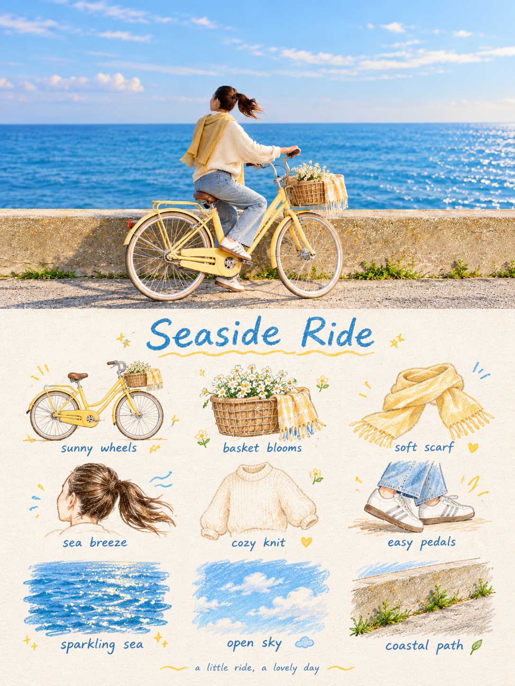

# 01 旅行涂鸦手帐

英文名称：Travel Journal。别名：travel、九宫格手帐、旅行手帐。

## 风格判断与执行要点

恰好9个可区分的视觉单元，均来自原照片的主体、局部、物品、动作或情绪。松散3×3布局，纸纹和手写文字；不复刻完整场景。不要补造旅行道具，不猜地名。

遵守主 SKILL.md 的共同执行流程；只加载本风格，不叠加其他风格规则。

## 效果参考

这是已提供的效果示例，用于理解画风，不是源照片；不复制示例主体、背景或文案到其他照片。效果图可能有分区或细节偏差，文字要求与用户当次明确指令为生成目标。

## 完整生成提示词

请将我上传的每一张照片分别制作成一张独立的高级设计海报，不多图拼接，每张照片单独输出。整体采用3:4竖版构图，上下两个区域高度严格1:1，各占画面50%。 上半部分保留原始照片，保持主体身份、结构、姿态、真实质感、自然光影和原有色彩氛围，仅进行轻微高级调色，使其具有艺术杂志、独立出版物与展览图像质感。为适配画幅，可自然扩展环境背景，但不得拉伸、扭曲或改变主体。 下半部分提取照片中最具识别性的主体、局部元素、动作线索、物件细节与叙事关系，重构为一套 3×3 模块化图标网格 + 手绘稚拙涂鸦插画 + 蜡笔/彩铅颗粒质感 + 手写文字 的视觉系统。不要完整描摹原图，也不要做写实插画，而是将复杂信息压缩为 9 个最值得被记住的视觉单元：可以是主体本身、局部特征、随身物件、植物、食物、交通方式、姿态、情绪符号或场景中的小记忆点。每个单元都应来自上方同一画面的语义延伸，使人一眼感到它们属于同一张照片的“记忆清单”。 构图采用隐性的 3×3 松散网格。九宫格只作为底层秩序，不必画得过于工整；每个图标的位置、大小、角度和落点都可轻微偏移，形成既有秩序又不机械的 loose grid / organic grid 感。顶部可加入一个简短手写标题，并配少量轻松的小波浪线、星点或符号；底部可加入一句极小的手写 caption，使整体像一页私人手帐、视觉日记或 collection sheet。留白必须充足，版面要松弛、可爱、克制而不凌乱。 画风采用Naïve Hand-drawn Doodle Illustration：形体简洁、略带稚拙感，轮廓轻微抖动、粗细不均、不完全闭合，保留有意识的不完美。填色不要铺得太满，允许看到纸纹、白色颗粒和边缘毛糙感。可混合黑色细线轮廓、彩铅/蜡笔填色和少量局部色块，不依赖真实光影塑造，而以 flat color / spot color 的方式建立图形关系。网格辅助线若出现，应极淡，像铅笔轻轻打出的底稿，而不是电脑绘制的规则表格。

## 调用示例

使用 $travel-photo-journal，用第1种「旅行涂鸦手帐」处理这张照片，只输出一张。
